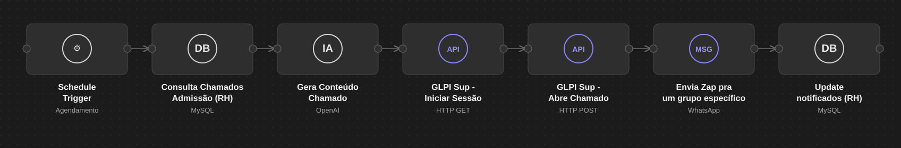
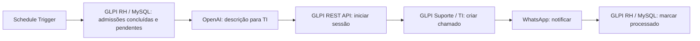

# GLPI Employee Onboarding Automation

Automação em n8n para transformar solicitações de admissão do RH em chamados técnicos de criação de acessos utilizando GLPI, OpenAI e WhatsApp.

## O problema

Na admissão, o RH reúne informações do novo colaborador em um chamado, enquanto a TI precisa convertê-las em uma solicitação de criação de acessos. A cópia manual entre sistemas gera retrabalho, perda de informações e atrasos no provisionamento. Este workflow acompanha os chamados do RH, interpreta o formulário, abre o chamado técnico, notifica o responsável e marca a origem como processada.

## Visão do workflow

*Ilustração sanitizada baseada na imagem anexada; endereços e identificadores internos foram omitidos.*

## Como funciona

1. O agendamento executa a cada três minutos.
2. A consulta seleciona chamados de uma categoria de admissão, com status elegível e `notifica_glpi_ti = 0`.
3. O node **Gera Conteúdo Chamado** transforma o conteúdo do formulário em uma descrição para a TI.
4. A API REST do GLPI de suporte inicia uma sessão e cria um Ticket.
5. A API de WhatsApp envia a notificação.
6. O chamado original recebe `notifica_glpi_ti = 1`.

O campo `notifica_glpi_ti` pode ser uma customização do ambiente; veja [configuração do GLPI](docs/configuracao-glpi.md).

## Importação e configuração

Importe [o workflow sanitizado](workflows/glpi-employee-onboarding.json) no n8n. Ele é estruturalmente importável, mas contém placeholders: **não execute antes de configurar** as Credentials de MySQL, OpenAI e WhatsApp e substituir URL, tokens e IDs fictícios do GLPI. O arquivo [.env.example](.env.example) é um inventário de parâmetros; o n8n **não lê esse arquivo automaticamente** e o JSON ainda não usa variáveis de ambiente. Faça a configuração na sua instância do n8n, em local seguro, sem publicar novo export com segredos.

O SQL de consulta contém `itilcategories_id = 9999` apenas como exemplo: substitua pelo ID da categoria de admissão do seu GLPI. O payload de criação também usa IDs `9999` como placeholders. Revise `type`, `status`, `urgency`, `impact` e `priority` conforme seu ambiente.

## Documentação

- [Arquitetura](docs/arquitetura.md)
- [Fluxo de admissão](docs/fluxo-admissao.md)
- [Configuração do GLPI](docs/configuracao-glpi.md)
- [Integrações](docs/integracoes.md)
- [Segurança](docs/seguranca.md)
- [Melhorias futuras](docs/melhorias-futuras.md)
- [Formulário fictício](examples/formulario-exemplo.md) e [chamado fictício](examples/chamado-gerado-exemplo.md)

O workflow original foi preservado fora deste repositório. A versão pública mantém sete nodes, conexões, prompt, expressões e ordem de processamento; apenas dados de infraestrutura e IDs de configuração foram substituídos.
