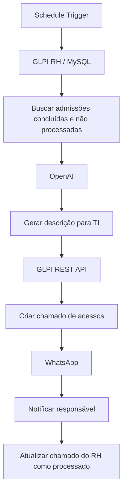

# Arquitetura

O n8n é a ponte entre o **GLPI RH** (origem) e o **GLPI Suporte / TI** (destino). O banco MySQL da origem fornece os chamados; o node OpenAI gera a descrição; a API REST do destino cria o Ticket; uma API compatível com WhatsApp notifica; por fim, o MySQL da origem registra o processamento.

A ordem acima descreve o workflow exportado. Falhas intermediárias e múltiplos itens ainda exigem tratamento específico; veja [melhorias futuras](melhorias-futuras.md).
